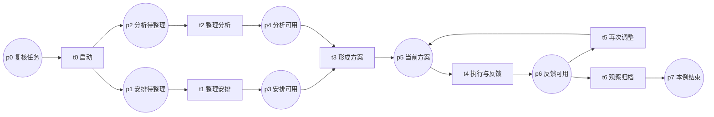

**3. 从案例到数学模型：每个符号和假设的含义**

[阅读入口](README.md) · [上一篇](02-evidence-and-case.md) · [引用与产物总目录](07-reference-and-artifact-register.md)

本篇完整解释候选 0.1 的结构。权威输入是[model.json](../analysis/model.json)，语义和预先保存的假设见[model.md](../analysis/model.md)。下文是对同一候选的展开，没有新增节点、行动规则或参数。

**3.1 三个容易混淆的对象**

| 对象 | 本例中的意思 | 不代表什么 |
|---|---|---|
| 位置 place | 一种工作条件，例如记录可用 | 一个运动员或一项生理数值 |
| token | 当前具备该工作条件的标记 | 康复程度、负荷值或成功概率 |
| 标识 marking | 全部位置上 token 的分布，即完整流程状态 | 仅某一个位置的名称 |

本例有八个位置，后来恰好也得到八个可达标识；两者数量相同只是这个结构的结果。一个标识可以同时在多个位置有 token，例如 p1、p2 同时存在。

**3.2 模型及初始条件**

取普通 Petri 网

\[
N=(P,T,F),\quad P=\{p_0,\ldots,p_7\},\quad
T=\{t_0,\ldots,t_6\}.
\]

\(F\) 包含位置到转移、转移到位置的有向连接。本例每条连接的权重为一，只研究一次工作实例。按 p0 至 p7 的顺序，标识为 \(m\in\mathbb N^8\)。

\[
m^{\mathrm{init}}=(1,0,0,0,0,0,0,0)^\mathsf T,\qquad
m^{\mathrm{final}}=(0,0,0,0,0,0,0,1)^\mathsf T.
\]

这里用上标区分初态和终态；后文的 \(m_i\) 表示位置 \(p_i\) 的 token 数。程序输出中的 `m0`、`m1` 等则是枚举状态的编号，不能与向量分量混读。

**3.3 八个位置与来源边界**

| 位置 | 条件含义 | 来源或假设 | 审核提醒 |
|---|---|---|---|
| p0 | 本次复核任务已建立 | E1 的研究抽象；A1 | 不是原论文提供的事件代码 |
| p1 | 初步负荷安排待整理 | E2；A1 | 表达工作待完成 |
| p2 | 因素分析待整理 | E2；A1 | 不断言所有原因可被确定 |
| p3 | 初步安排记录可用 | A1 | 不等于生理恢复完成 |
| p4 | 因素分析记录可用 | A1 | 不等于每项解释已被证实 |
| p5 | 当前方案可执行 | E3；A2 | 当前结构没有表示全部现实执行条件 |
| p6 | 本轮执行与反馈记录可用 | E4；A2 | 多种现实活动被压缩为一个条件 |
| p7 | 本次观察窗口已归档 | A3 | 不等于恢复成功或停止执教 |

E1–E5 可回到[案例提取](../public-case.md)。由 E 到 p 的对应属于研究抽象，并未取得原教练对模型含义的确认。

**3.4 七个转移及可发生条件**

| 转移 | 名称 | 输入条件 | 产生的条件 |
|---|---|---|---|
| t0 | 启动复核 | p0 | p1、p2 |
| t1 | 整理初步安排 | p1 | p3 |
| t2 | 整理因素分析 | p2 | p4 |
| t3 | 形成组合方案 | p3、p4 | p5 |
| t4 | 执行并取得反馈 | p5 | p6 |
| t5 | 再次调整 | p6 | p5 |
| t6 | 归档本次观察 | p6 | p7 |

令 \(\mathrm{Pre}_{p,t}\) 表示转移 t 是否从位置 p 消耗一个 token，\(\mathrm{Post}_{p,t}\) 表示是否向 p 产生一个 token。转移 t 可发生，当且仅当：

\[
m\geq\mathrm{Pre}_{\cdot,t},
\]

不等式按分量比较。发生一次以后：

\[
m'=m-\mathrm{Pre}_{\cdot,t}+\mathrm{Post}_{\cdot,t}.
\]

例如，t3 同时需要 p3 和 p4；只有其中一个 token 时不能发生。条件满足表示数学结构允许推进，不能直接解释为教练在现实中应当采取该行动。[Petri 网与工作流方法来源 M1](https://www.vdaalst.com/publications/p53.pdf)

**3.5 完整流程图**

图中圆形是条件，方形是行动。t0 产生两项待办条件；t1 与 t2 的发生顺序可以交换；t3 要求两项记录齐备；p6 之后允许两条不同路径。

这种并行表示的是依赖与可交换顺序，没有引入实际用时，也未证明两项现实工作同时开始或结束。p6 上只有一个 token 时，t5、t6 各自可发生；其中一个消耗 token 后，另一个不能立刻发生。这表达分支选择，没有给出选择概率。

**3.6 用净变化矩阵复算一次转移**

令 \(C=\mathrm{Post}-\mathrm{Pre}\)。按下表的行列顺序，当前模型得到：

| C | t0 | t1 | t2 | t3 | t4 | t5 | t6 |
|---|---:|---:|---:|---:|---:|---:|---:|
| p0 | -1 | 0 | 0 | 0 | 0 | 0 | 0 |
| p1 | 1 | -1 | 0 | 0 | 0 | 0 | 0 |
| p2 | 1 | 0 | -1 | 0 | 0 | 0 | 0 |
| p3 | 0 | 1 | 0 | -1 | 0 | 0 | 0 |
| p4 | 0 | 0 | 1 | -1 | 0 | 0 | 0 |
| p5 | 0 | 0 | 0 | 1 | -1 | 1 | 0 |
| p6 | 0 | 0 | 0 | 0 | 1 | -1 | -1 |
| p7 | 0 | 0 | 0 | 0 | 0 | 0 | 1 |

给定已启用的转移 t，其对应列就是该次发生的净变化：\(m'=m+C_{\cdot,t}\)。

从初态发生 t0 得到 \(\{p_1,p_2\}\)。若先发生 t2，得到 \(\{p_1,p_4\}\)；再发生 t1，得到 \(\{p_3,p_4\}\)，此时 t3 才可发生。另一种顺序 t1 → t2 到达同一个标识。

净变化矩阵不能替代全部输入条件。例如，一条转移若从同一位置消耗一个 token 又放回一个，该位置净变化为零，但行动仍需要这个 token。第 4 篇的反例 A 正好展示这一点。审核时要同时看 inputs、outputs 和可发生规则。

**3.7 四项假设逐项解释**

| 假设 | 当前选择 | 为什么不能由程序证明 | 可能改变它的新材料 |
|---|---|---|---|
| A1 粒度与汇合 | 分成两项整理，组合方案前要求记录齐备 | 程序只执行写入的前提，不知道现实是否必需 | 有案例在某项准备记录尚不可用时已形成方案 |
| A2 反馈原子化 | 一轮执行和信息收集合成 t4 | 现实延迟、缺测、多人协作没有被输入 | 关键反馈分批到达，且先到信息已改变行动 |
| A3 观察终点 | p7 表示本次研究归档 | 归档是观察范围定义，不是生理事实 | 需要研究跨观察窗口的连续决定 |
| A4 非确定选择 | p6 允许调整或归档 | 没有输入条件或概率可供估计 | 新材料提供当时备选、理由及选择时点 |

此表中的“可能改变”是后续检验方向，没有声称已经观察到这些反例。原始假设版本见[model.md 第 3 节](../analysis/model.md)，研究方案见[protocol.md](../protocol.md)。

**3.8 补充阅读：职责与候选数学对象怎样对应**

第一篇从具体情境介绍了职责范围。下面保留完整对应，供需要审核术语与方法选择的读者查阅。S1 指国际教练框架 Version 1.2 的公开节选，S2 指 SHAPE America 官方标准；身份、版本和读取边界见[来源审计](../source-audit.md)。[S1 原始节选](https://us.humankinetics.com/blogs/excerpt/all-coaches-should-strive-to-fulfill-these-six-primary-functions)、[S2 官方条款](https://shapeamerica.org/standards/coaching/)

职责到数学对象的对应是本研究的解释，不是原标准已给出的数学模型。表中行号不是执行顺序；列出的候选对象也没有全部纳入本轮八位置模型。

| 序号 | 职责范围 | 原条目定位 | 本研究需要收集什么 | 候选数学对象 |
|---|---|---|---|---|
| 1 | 目标与方向 | S1 职能 1；S2 1、3 | 目标的提出者、优先次序、时间范围 | 目标集合、约束、决策时域 |
| 2 | 资源与环境 | S1 职能 2；S2 5、24 | 人员、场地、时间等怎样限制选择 | 可行行动集合、资源约束 |
| 3 | 沟通与决定权 | S1 职能 3；S2 9、26 | 信息来源、参与者、决定权 | 观测与行动者关系 |
| 4 | 训练与比赛组织 | S1 职能 4；S2 24、32 | 计划到执行的过程及偏差 | 任务、状态、事件 |
| 5 | 观察与调整 | S1 职能 5；S2 34、36–37 | 触发复核的信息与行动理由 | 历史、条件规则、策略 |
| 6 | 评价与学习 | S1 职能 6；S2 38–39 | 如何评价决定、修改后续判断 | 反馈与规则修订 |

这张表用于检查覆盖缺口，不能直接生成训练处方。本轮没有把两份来源整套设为产品验收标准；正式采用的条款及其情境解释仍需另行确认。

**3.9 补充阅读：进一步研究决策时，怎样表示当时的信息**

下面的符号用于明确未来可能研究的选择机制，不是当前流程网已经估计出的参数或策略。

在未来的决策研究中，可把当时可见的观察与行动历史记作：

\[
h_t=(o_0,a_0,o_1,\ldots,a_{t-1},o_t).
\]

这里的 \(o_t\) 只能包含截至该时点已获得的信息。随后比赛的结果不能提前写入。\(a_t\) 可以是一个训练相关选择，也可以是补充询问等获取信息的行动；具体类别还需从案例核对。

再用

\[
a_t\sim\pi(\cdot\mid h_t,c_t,g_t)
\]

表示待解释的选择机制，其中 \(c_t\) 是情境，\(g_t\) 是目标。符号 \(\sim\) 在此允许选择具有不确定性；确定性规则也可以作为只给一个行动非零概率的特例。当前没有估计这项策略，也没有证明这些变量足以解释教练的选择。

运动员状态与信息历史尤其需要区分：教练可能已经完成资料收集，但仍不能完全知道运动员状态；工作记录齐备和事实确定是两个判断。

**3.10 补充阅读：不同问题需要哪些方法和证据**

研究对象可以分成五个层次。相同材料可能帮助多个层次，但每项结论需要各自的证据。

| 层次 | 要说明什么 | 一个具体例子 |
|---|---|---|
| 职责 | 哪些工作应进入研究范围 | 目标协商和资源安排是否被遗漏 |
| 流程 | 工作之间有什么依赖、并行与回路 | 两项材料是否必须齐备才能形成方案 |
| 决策 | 根据当时的信息怎样选行动 | 先询问、继续观察、保留计划还是调整 |
| 后果 | 行动之后发生什么，以及能否归因 | 表现改善是否由某项改变引起 |
| 工程 | 软件是否忠实实现已确认的对象 | 缺少输入时能否正确保留待处理状态 |

工作流程没有死路，不足以证明选出的训练最合适；成功回放旧案例，也不足以证明能预测新案例。进一步选择方法时，需要先明确要回答其中哪一类问题。

| 方法 | 当前能帮助回答的问题 | 使用条件与限制 |
|---|---|---|
| 条件规则或状态转移图 | 哪些条件下进入下一任务；哪里有冲突或遗漏 | 表达直接，适合作为比较基线；不能靠不断补规则掩盖反例 |
| Petri 网 / WF-net | 并行任务、汇合和回路怎样影响完成 | 本轮能完整枚举；只检查声明的工作条件结构 |
| POMDP | 信息不完全时如何表示状态判断、获取信息与选择 | 还需要状态、转移、观测和回报依据；本轮没有这些参数 |

方法定义分别可回查 [M1 工作流论文](https://www.vdaalst.com/publications/p53.pdf)与 [M2 部分可观测决策论文](https://people.csail.mit.edu/lpk/papers/aij98-pomdp.pdf)。本轮比较的是表达范围，尚未进行工程性能评测。

当前公开个案提供了粗粒度过程，却缺少逐次行动选择材料。因此，本轮先把可明确表达的局部依赖写出并公开假设，没有据此建立完整的决策策略。

**3.11 几个需要分开的判断**

p3、p4 同时有 token，只表示两项工作记录可用；原因是否查明、运动员是否恢复，需要其他证据。判断行动可发生时，要核对输入条件 Pre，不能只看净变化矩阵 C。t5 与 t6 都可发生，则表示结构保留两个分支；它没有给出二者同样安全或有效的证据。

下一篇：[逐步推导与形式验证](04-proof-and-counterexamples.md)。
