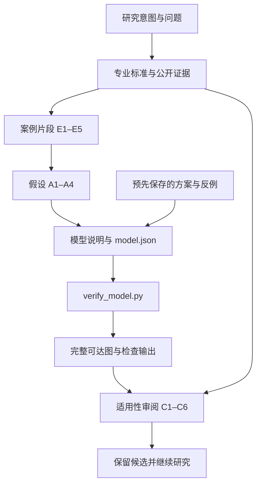

**精英耐力教练工作流程建模：学习、审核与复现指南**

研究 001｜第一轮公开案例｜整理日期：2026-10-23

这组文章解释一项研究怎样从专业职责和公开案例，走到一个可以检查的数学对象，再判断结果能支持什么。读完后，你应能沿着原文、假设、模型、代码和实际输出逐项核对，也能重新运行现有计算。

当前结果是：一个局部流程候选完成了形式验证；真实决策解释能力、跨案例适用性和训练效果仍缺证据。本组文章整理已有研究，未把这个候选改成完整教练系统。

**1. 从这里选择阅读路径**

| 序号 | 文章 | 读完要能解释什么 | 直接关联的研究产物 |
|---|---|---|---|
| 1 | [一张训练计划背后的教练工作](01-question-and-standards.md) | 为什么要研究工作过程；标准、案例与模型怎样分工 | 问题、职责说明、来源审计 |
| 2 | [公开证据与首个案例](02-evidence-and-case.md) | 哪些是论文报道，哪些是研究者推断，哪些仍未知 | 案例提取、来源审计 |
| 3 | [从案例到数学模型](03-model-and-assumptions.md) | 每个符号、位置、转移和假设究竟表示什么 | 模型说明、模型 JSON |
| 4 | [逐步推导与形式验证](04-proof-and-counterexamples.md) | 八个状态、九条边怎样得到；两个反例为何失败 | 预定方案、实际输出、结果解释 |
| 5 | [读懂代码并亲自复现](05-code-and-reproduction.md) | 程序检查了什么；如何运行、比较结果和定位差异 | Python 程序、模型输入、原始与复现输出 |
| 6 | [审核结论与工程化边界](06-review-and-engineering.md) | 什么已经验证，什么还不能声称；下一轮应检验什么 | 适用性审阅、转化决定、六阶段记录 |
| 7 | [全部引用与产物总目录](07-reference-and-artifact-register.md) | 每项依据在哪里；每个文件处于证据链的哪一段 | 全部原有文件、公开来源和新增整理产物 |

1. **学习路径：** 按 1 → 2 → 3 → 4 → 5 → 6 阅读，遇到出处疑问时打开第 7 篇。
2. **审核路径：** 先读第 7 篇和第 6 篇，再从一项结论逆向核对结果、模型假设和原始来源。
3. **复现路径：** 先执行第 5 篇，再用第 4 篇检查状态、路径和失败见证；不要只看终端有没有报错。

另保留[单文件完整稿](../analysis/complete-report.md)，便于一次复制。它是叙述版入口，细节审核应继续打开对应章节与原始文件。

**2. 这组文件怎样相互关联**

图中的箭头表示依据关系。例如，代码输出可以支持某项形式性质，但不能越过假设审阅，直接证明模型符合真实教练工作。第 7 篇提供每个节点的具体文件链接。

**3. 阅读时区分四类状态**

| 标记 | 在这项研究中的含义 |
|---|---|
| VERIFIED | 有对应层次的证据，且范围已写明 |
| PARTIAL | 已有部分支持，关键前提或覆盖范围仍有缺口 |
| FAILED / FAIL | 指定检查失败；两个预设错误模型应当得到这一结果 |
| UNKNOWN | 未得到所需证据，不能据此断言成立或不成立 |

这里存在三种不同的“通过”：研究记录检查通过、声明模型的形式检查通过、程序执行与预期相符。它们不等于真实教练决策有效，更不等于产品可发布。第 5、6 篇分别解释这些含义。

**4. 为什么一些旧文件还写着“尚未建立模型”**

[public-case.md](../public-case.md)保留了取得案例时的材料判断；[findings.md](../findings.md)的前四节保留了方法筛选时的状态。[较早的阶段检查](../evidence/gate-check-before-public-case.json)记录了当时因案例缺口而停在第二阶段的事实。

这些是阶段记录。最新的研究结果以[results.md](../analysis/results.md)、[validation.md](../analysis/validation.md)和[decision.md](../analysis/decision.md)为准；[最终阶段记录](../evidence/gate-check.json)说明本轮材料链已闭合。本组文章将两者连接起来，避免用后来的结果改写此前的研究过程。

**5. 完整性范围**

本次整理以研究目录中原有的 **17 个文件、12 个已引用公开链接**为起点，全部收入第 7 篇。七项核心来源 S1–S5、M1–M2与两项仅取得目录/摘要的候选资料分别列明；未读全文不会被写成已核对证据。

文章之间使用相对链接。移动或复制时，保留整个 `001-elite-endurance-coach` 文件夹及其内部目录关系。模型复现使用 Python 标准库；研究流程检查器属于项目中的另一个工具，其外部位置和可移植性限制见第 5 篇。

开始阅读：[第 1 篇：一张训练计划背后的教练工作](01-question-and-standards.md)。
