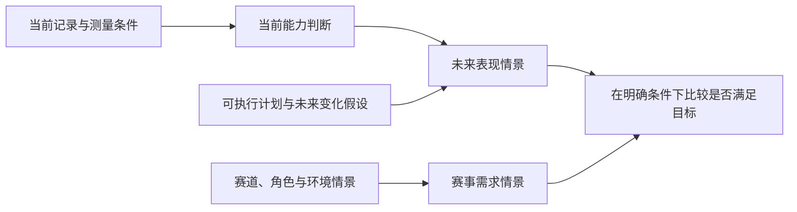

# 目标可达性：先分清做不到、条件不足与尚不知道

[本轮阅读入口](#/article/series-guide?section=publication) · Q003、Q007 · [下一篇：赛事需求](#/article/p1-004-02-event-demands)

判断目标是否现实，首先要知道目标指什么、何时实现、允许投入什么，以及哪些事实足够可靠。“当前没有证据支持”与“已经证明不可能”之间，差了很重要的一步。

## 三种不同的判断

第一种是明确约束冲突。例如，已经确定的四项活动各需两小时，而同一时间窗总共只允许六小时，且活动不可拆分也不可取消。八小时不能装进六小时，这是当前条件下的不可行。它不需要推断人的潜在能力。

第二种是给定模型下不太可能。例如，模型对未来表现的预测大多低于目标。这仍依赖模型是否适合此人、是否包含计划和环境、预测误差是否经过后续验证。低概率也不是逻辑上的不可能。

第三种是信息不足。例如，只有日常轻松骑行，既不清楚当前极限能力，也没有可靠的个人变化模型。此时给出一个精确概率，会把未知藏进数字。更诚实的结果可能是列明可达与不可达的条件，说明什么信息能区分它们。

这三种情况对应不同的下一步：解除冲突、比较条件与代价，或补足有决定价值的信息。不能全部用一个红色“不切实际”标签处理。

## 当前能力的分布，不是未来达标的分布

[上一轮的日常能力文章](#/article/p1-003-01-daily-capacity)说明，日常表现可能没有接近极限。即便暂时已经得到一个合理的当前能力分布，预测未来还需要变化过程。

下面是本轮实际计算的虚构例子。设一个能力指标当前为正态分布，均值250、标准差10，目标为270。这里的10是标准差，不是置信区间半宽；这些数字不代表某位运动员。

设未来指标等于当前指标X加变化G。只改变对G的假设，就会得到：

| 未来变化假设 | 未来指标均值 | 达到270的模型概率 |
|---|---:|---:|
| 没有变化 | 250 | 2.28% |
| G均值10、标准差5，与X独立 | 260 | 18.55% |
| G均值20、标准差5，与X独立 | 270 | 50.00% |

三行使用完全相同的当前信息。差别来自未来模型，而不是数据忽然变得更准确。后两行的方差为 `10²+5²=125`；若X与G有关，还要加上协方差项。[计算C01](#/article/series-guide?section=publication)

因此，把当前能力超过270的2.28%，直接称为数周后达到270的概率，回答错了时间点。反过来，任意给当前分布加宽，也不能保证未来预测已经校准。“有区间”和“区间有可靠覆盖”是两件事。

真实赛事还多一层：所需表现会随天气、路线、对手与战术改变。要预测达成某个赛事目标，既要处理未来能够做什么，也要处理届时需要做什么。若只有其中一侧的分布，结论仍不完整。

## 暂时没有可靠概率，也能作条件判断

假设目标仍是270。若未来可能范围为235—290，其中一些情景能达到，一些不能；若为230—260，所列情景全部不能达到；若为275—300，所列情景全部达到。[计算C02](#/article/series-guide?section=publication)

这里的“全部”只覆盖给定范围，不能保证现实不会超出范围。区间也没有告诉我们每个值发生的概率，不能把“范围的一半高于目标”写成50%成功率。条件判断的价值，是明确决定依赖什么，而不是用范围伪装成概率。

日常数据可以补充已完成的表现、相近条件下的稳定程度和实际可用时间。它不能仅凭记录天数达到某个固定门槛，就自动完成当前能力识别和未来变化校准。一次短时表现也不能独自证明另一时长的能力。

## 协商应围绕条件，而不是替人判断动机

可讨论的变化包括延长时间、改变结果目标、改变可投入资源，或者暂时保留愿望、先回答一个更近的能力问题。不同变化牺牲的东西不同，最终取舍需要由用户决定。

例如，可以把判断写成：“当前记录不足以支持在原日期达到这个目标的可靠概率。已确认的时间预算可以满足A类准备，但B项需求还缺可比表现。我们可以保留原目标，先核对B；也可以比较延长期限后的方案。”这是一种待评价的沟通方式，没有宣称它已经被证实能保护每个人的动机。

不宜用未经验证的百分比使某个选择看起来更有说服力，也不宜把训练时长少、没有执行某次课解释成缺乏雄心。资源约束和价值取舍都可以是真实的，不能据此否定用户表达的目标。

旧答给出的CTL每周增长界限、固定FTP增速、ACWR或TAI硬阈值，不能直接充当个人“生理不可达”的证明。关于ACWR的原数据再分析显示，用人为分母也可能得到相似关联，这进一步限制了将某个比值当作因果风险依据的做法；它没有提供本任务需要的个人伤病概率。[Impellizzeri等，2021](https://pubmed.ncbi.nlm.nih.gov/33332011/)

本轮可以确定的是判断结构：先分清约束、当前测量、未来变化和赛事需求，再决定现在能说多强的话。具体个人的达标概率，以及怎样协商最能帮助理解和保持投入，仍需要相应数据与评价。

[来源与原答核对](#/article/series-guide?section=publication) · [全部计算](#/article/series-guide?section=publication) · [适用边界](#/article/series-guide?section=publication)
